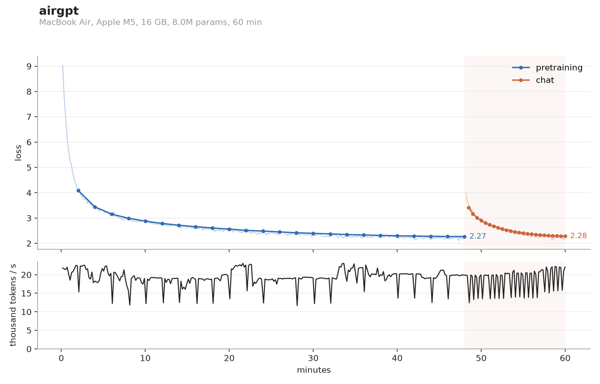

# airgpt

train a small chatbot from scratch on a mac. tokenizer, pretraining, chat finetuning, all of it, on your laptop.


^ that's an 8M param model i trained in an hour on my macbook air (m5, 16gb, no fan). it's running at normal speed.

i wanted to train my own llm but everything i found (nanochat, minimind etc) needs an nvidia gpu, so i made this. it's built on [mlx](https://github.com/ml-explore/mlx) and it's around 1300 lines of python.

## running it

```
git clone https://github.com/navthings/airgpt
cd airgpt
python3 -m venv .venv && source .venv/bin/activate
pip install -r requirements.txt
python train.py --preset smoke
```

smoke takes 3 minutes and is just to check everything works. then:

```
python train.py --preset hour
python chat.py runs/hour
```

there's also `--preset night`, a 40M model that trains for 8 hours. you can change how long any of them run with `--minutes`, the learning rate schedule stretches to fit whatever time you give it.

the first run downloads tinystories and some cosmopedia from hugging face. to use different data there's `--mix`, like `--mix fineweb-edu` or `--mix tinystories=0.7,wikipedia=0.3` (also works with `cosmopedia`, `gutenberg`, or any hugging face dataset that has a text column). you can train on your own text files too with `--text ~/notes`.

on an 8gb mac it should still work, it splits the batches up when they won't fit in memory. i haven't tested it on an actual 8gb one yet so let me know if it breaks.

## results

hour preset on my air:

- 8M params, 55M tokens, val loss 2.27
- around 20k tokens/s the whole time. it didn't throttle at all, which i didn't expect
- peaked at 5.8gb of memory

it prints a sample every 2 minutes while it trains, same prompt each time. here's a few from the run:

**2 min:** Once upon a time, there was a little boy named Tim. Timmy loved to play with his friends. One day, Timmy was a very excited.

**6 min:** Once upon a time, there was a little girl named Lily. She had a big red dress that she loved to play with. One day, Lily went to a party with her mom.

**46 min:** Once upon a time, there was a little girl named Lily. She loved to play with her toys and her favorite toy was a big, red ball. One day, Lily's mom asked her to help



the chat part is pretty bad at 8M params. it says hi fine and then makes stuff up:

```
> hi!
Hello! How can I help you today?

> what is the capital of france?
The capital of france is the capital of the france of the tech of decimal.
```

night preset results coming soon, it's training right now.

## bench

`python bench.py` trains on random data for 2 minutes and tells you how fast your mac is. nothing to download. if you post your numbers in an issue i'll add them here.

## speedrun

if you want to try and make it better: lowest val loss on the hour preset wins. records are per chip since macs are so different, so if nobody's done your chip yet you're automatically first.

you can change anything except the data and the eval. pretraining has to stay at 48 minutes like the preset. the score is `pretrain.val_loss` in `runs/hour/summary.json`. open a pr with your row plus your `summary.json` and `log.jsonl`, and say what you changed.

| chip | val loss | who | what changed |
|---|---|---|---|
| m5 (air, 16gb) | 2.265 | [@navthings](https://github.com/navthings) | baseline |

## how it works

1. downloads text and trains a byte-level bpe tokenizer on it (8192 tokens, written from scratch in `tokenizer.py`)
2. pretrains a llama-style transformer on that text, which is where it learns english
3. finetunes it on short chats from [everyday-conversations](https://huggingface.co/datasets/HuggingFaceTB/everyday-conversations-llama3.1-2k) and [smol-smoltalk](https://huggingface.co/datasets/HuggingFaceTB/smol-smoltalk). the loss only counts the assistant's replies so it learns to answer instead of copying you
4. `chat.py` lets you talk to it

the learning rate is based on time not steps (3% warmup, then cosine down to 10%), so a slow mac just sees fewer tokens but still finishes on time.

a few other things:

- it shows the mac's thermal state while training and pauses for 30s if it ever gets to critical
- it keeps the mac awake, but closing the lid still sleeps it so leave it open
- ctrl-c saves and tells you how to resume. `--restart` starts a run over
- sampling defaults to temperature 0.6 with min-p 0.1 because small models do better cold (that's what my current paper is about)
- `python plot.py runs/hour` makes the loss/speed graph

| file | |
|---|---|
| `train.py` | training loop, logging, checkpoints |
| `model.py` | the transformer (rmsnorm, rope, gqa, swiglu, kv cache) |
| `tokenizer.py` | bpe tokenizer |
| `prepare.py` | downloads and tokenizes the data |
| `chat.py` | chat with it |
| `bench.py` | speed test |
| `config.py` | presets |
| `mac.py` | chip, ram, thermal stuff |
| `plot.py` | graphs |
| `ui.py` | terminal output |

## thanks

[nanogpt](https://github.com/karpathy/nanoGPT), [nanochat](https://github.com/karpathy/nanochat) and [minimind](https://github.com/jingyaogong/minimind), which this is basically a mac version of. [tinystories](https://huggingface.co/datasets/roneneldan/TinyStories) and hugging face's smollm datasets for the data, and mlx for making it possible on a laptop.

mit license
